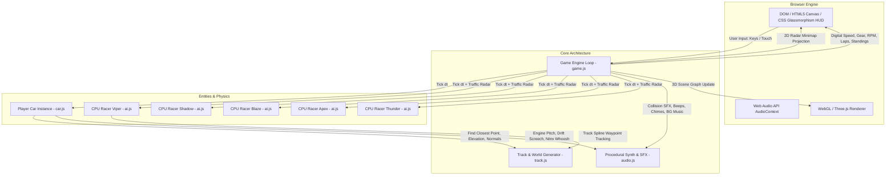
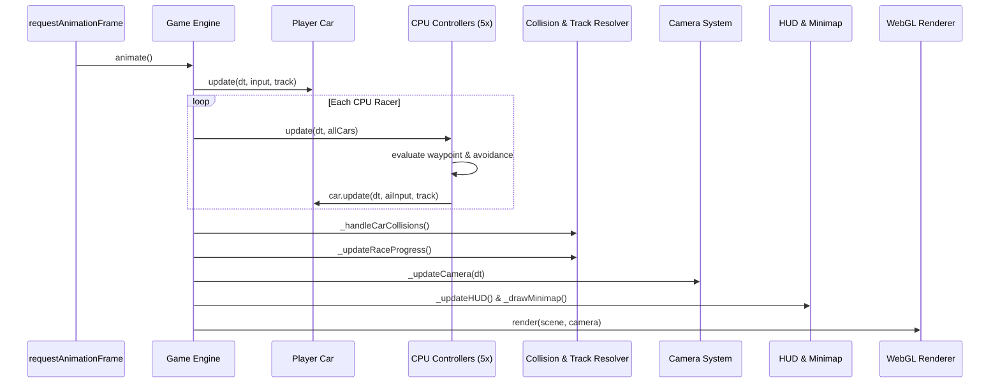
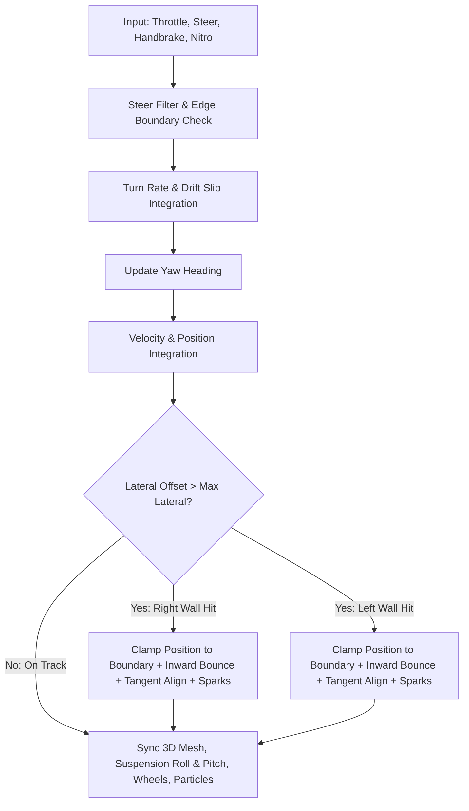
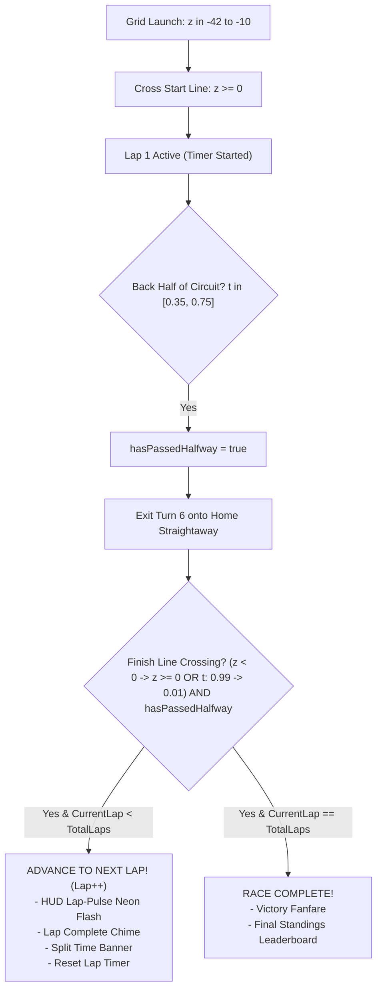
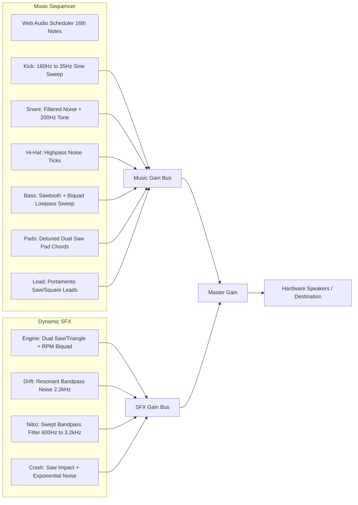

# 🏎️ SPEED RACER GP 3D — System Architecture

This document provides a comprehensive technical breakdown of the architecture, subsystems, mathematical models, and data pipelines powering **SPEED RACER GP 3D**.

---

## 1. High-Level Architecture Overview

The game is designed with a **decoupled, modular architecture** where rendering, physics, audio, AI, and track geometry operate with clear boundaries:

---

## 2. Subsystem Breakdown

### 2.1. Game Loop & Orchestration ([`game.js`](file:///c:/Users/ppuga/OneDrive/Desktop/AI%20game%202/js/game.js))
The central engine managing state machines, render orchestration, collision matrices, timing, and cameras.

- **State Machine**:
  - `MENU` $\rightarrow$ `COUNTDOWN` (3... 2... 1... GO!) $\rightarrow$ `RACING` $\rightarrow$ `FINISHED` (or `PAUSED`).
  - **Pause Lifecycle**:
    - Triggered via `ESC`, `P` key, HUD pause button, or on-screen touch button.
    - Pauses simulation, silences continuous engine/screech/nitro audio, and ducks background music.
    - Dynamically accumulates paused duration ($\Delta t_{\text{paused}}$) to offset `raceStartTime` and `lapStartTime`, guaranteeing timing precision when resumed.
  - **Lap & Checkpoint Lifecycle**:
    - Configurable race lengths: 1 Lap (Sprint), 3 Laps (GP), 5 Laps (Endurance).
    - 3-sector checkpoint gating ($t \in [0.25, 0.55, 0.80]$): initial launch across $z = 0$ activates Lap 1 timing without incrementing the lap count; laps strictly advance upon completing all 3 track sectors and crossing the finish line.
- **60 FPS Update Pipeline**:
  1. Computes delta time $dt$ with clamped threshold ($\max(dt) = 0.1\text{s}$) to avoid frame-skip tunneling.
  2. Updates player vehicle physics ([`player.update()`](file:///c:/Users/ppuga/OneDrive/Desktop/AI%20game%202/js/car.js#L275-L390)).
  3. Updates all 5 CPU controllers ([`AICarController.update()`](file:///c:/Users/ppuga/OneDrive/Desktop/AI%20game%202/js/ai.js#L38-L175)).
  4. Evaluates $O(N^2)$ car-to-car elastic impulse collisions.
  5. Computes continuous spline progression for race ranking (1st to 6th place).
  6. Smoothly interpolates the camera (4 modes: Chase, Close Bumper, Cockpit/Hood, Drone).
  7. Redraws radar minimap and updates DOM HUD.

---

### 2.2. Track & Spline Mathematics ([`track.js`](file:///c:/Users/ppuga/OneDrive/Desktop/AI%20game%202/js/track.js))
Procedural 3D circuit built using parametric Catmull-Rom spline curves.

- **Curve Generation**:
  - `THREE.CatmullRomCurve3` parameterized with 18 control points creating sweeping banked curves, S-chicanes, elevation crests ($y \in [0, 7]$), and hairpins.
  - Precomputes 600 equidistant sample points with unit tangent vectors $\mathbf{T}(t)$ and lateral normal vectors $\mathbf{N}(t) = \mathbf{T}(t) \times \mathbf{U}$.
- **Road & Barrier Geometry**:
  - Continuous quad-strip ribbon extrusion for asphalt surface (width $= 24\text{m}$).
  - Red-and-white rumble strip curbs (width $= 1.8\text{m}$).
  - Continuous extruded 3D guardrail walls on both flanks ($h = 1.8\text{m}$, distance $= 13.9\text{m}$) with illuminated top neon strips and support posts.
- **Fast Coordinate Projection**:
  - `findClosestTrackPoint(pos)` performs coarse-to-fine distance minimization across sample points:
    $$\text{dist}^2 = (x - x_i)^2 + (z - z_i)^2$$
    Computes signed lateral displacement:
    $$\text{lateralOffset} = (\mathbf{P}_{\text{car}} - \mathbf{P}_{\text{track}}) \cdot \mathbf{N}$$

---

### 2.3. Vehicle Dynamics & Boundary Physics ([`car.js`](file:///c:/Users/ppuga/OneDrive/Desktop/AI%20game%202/js/car.js))

The vehicle model delivers responsive arcade physics with realistic drift dynamics, weight transfer, and track boundary safety:

- **Boundary Enforcement Math**:
  $$\text{maxLateral} = \frac{\text{trackWidth}}{2} + 0.5 = 12.5\text{m}$$
  If $|\text{lateralOffset}| > \text{maxLateral}$:
  1. **Strict Position Clamping**:
     $$\mathbf{P} \leftarrow \mathbf{P} - \mathbf{N} \cdot (\text{lateralOffset} - \text{sign}(\text{lateralOffset}) \cdot \text{maxLateral})$$
  2. **Inward Bounce Impulse**:
     $$v_{\text{lateral}} = \mathbf{V} \cdot \mathbf{N}$$
     $$\mathbf{V} \leftarrow \mathbf{V} - \mathbf{N} \cdot (v_{\text{lateral}} \times 1.5)$$
  3. **Tangent Heading Alignment**:
     $$\theta_{\text{target}} = \text{atan2}(T_x, T_z), \quad \theta \leftarrow \theta + \Delta\theta \times 0.45$$
  4. **Dynamic Sparks Particle Emission**:
     Shoots 5-6 luminous spark particles with gravity and velocity opposite to collision normal.

---

### 2.4. Multi-Car CPU AI System ([`ai.js`](file:///c:/Users/ppuga/OneDrive/Desktop/AI%20game%202/js/ai.js))

5 distinct CPU racers operate with individual driving profiles:

| Driver | Color | Style | Top Speed | Aggression | Cornering |
| :--- | :--- | :--- | :--- | :--- | :--- |
| **Viper** | `#ff1744` (Crimson) | Aggressive inside dives | $73\text{ m/s}$ | $0.85$ | Late Braking |
| **Shadow**| `#263238` (Charcoal/Gold)| Defensive racing line | $72\text{ m/s}$ | $0.65$ | Smooth Apex |
| **Blaze** | `#ff6d00` (Flame Orange)| Fast drafter & Nitro user| $71\text{ m/s}$ | $0.80$ | Opportunistic |
| **Apex**  | `#00e676` (Acid Lime)  | High-speed drifter | $72.5\text{ m/s}$ | $0.70$ | Agile Chicane |
| **Thunder**|`#d500f9` (Royal Purple)| Heavy lane holder | $73.5\text{ m/s}$ | $0.75$ | Power Out |

- **Curvature Lookahead & Safe Cornering**:
  Measures angle $\phi$ between current tangent $\mathbf{T}(t)$ and lookahead tangent $\mathbf{T}(t + \Delta t)$:
  $$v_{\text{safe}} = v_{\max} \cdot \left(1.0 - \min\left(1.0, \frac{\phi}{1.1}\right) \cdot (1.1 - 0.4 \cdot \text{patience})\right)$$
- **Traffic Radar & Lane Shifting**:
  Scans cars within $45\text{m}$ frontal cone. If impeded by a slower car:
  $$\text{targetLaneOffset} \leftarrow \begin{cases} -5.5\text{m} & \text{if clearance on inside left} \\ +5.5\text{m} & \text{if clearance on outside right} \end{cases}$$

---

### 2.5. Race Manager & Next Lap Progression ([`game.js`](file:///c:/Users/ppuga/OneDrive/Desktop/AI%20game%202/js/game.js))

The lap management system controls race progression, finish line crossing validation, and dynamic HUD transitions:

- **Dual Finish Line Detection**:
  $$\text{Crossing} = \left(\mathbf{P}_{\text{prev}, z} < 0 \land \mathbf{P}_{\text{curr}, z} \ge 0 \land |x| \le \frac{\text{width}}{2} + 3\right) \lor \left(t_{\text{prev}} > 0.75 \land t_{\text{curr}} < 0.25\right)$$
  Validated strictly when `hasPassedHalfway === true`, guaranteeing accurate lap transitions with zero false starts.

---

### 2.6. Procedural Web Audio Engine ([`audio.js`](file:///c:/Users/ppuga/OneDrive/Desktop/AI%20game%202/js/audio.js))

100% synthesized through native Web Audio API graph nodes — zero external audio assets:

---

## 3. Directory & File Reference

| File | Purpose | Key Symbols |
| :--- | :--- | :--- |
| [`index.html`](file:///c:/Users/ppuga/OneDrive/Desktop/AI%20game%202/index.html) | Main HTML5 DOM, Canvas, Glassmorphism HUD, Modals | `#game-canvas`, `#hud`, `#start-modal` |
| [`style.css`](file:///c:/Users/ppuga/OneDrive/Desktop/AI%20game%202/style.css) | Cyberpunk styling, neon gauges, countdown animations | `.gauge-cluster`, `.minimap-card` |
| [`js/audio.js`](file:///c:/Users/ppuga/OneDrive/Desktop/AI%20game%202/js/audio.js) | Web Audio procedural music sequencer & continuous SFX | [`SoundSystem`](file:///c:/Users/ppuga/OneDrive/Desktop/AI%20game%202/js/audio.js#L7), `_scheduler` |
| [`js/track.js`](file:///c:/Users/ppuga/OneDrive/Desktop/AI%20game%202/js/track.js) | Catmull-Rom 3D track spline, guardrails, scenery | [`RaceTrack`](file:///c:/Users/ppuga/OneDrive/Desktop/AI%20game%202/js/track.js#L7), `findClosestTrackPoint` |
| [`js/car.js`](file:///c:/Users/ppuga/OneDrive/Desktop/AI%20game%202/js/car.js) | 3D supercar geometry, arcade physics, boundary collision | [`Car`](file:///c:/Users/ppuga/OneDrive/Desktop/AI%20game%202/js/car.js#L7), `update`, `_spawnBarrierSparks` |
| [`js/ai.js`](file:///c:/Users/ppuga/OneDrive/Desktop/AI%20game%202/js/ai.js) | 5x CPU driver logic, radar sensing, overtaking, braking | [`AICarController`](file:///c:/Users/ppuga/OneDrive/Desktop/AI%20game%202/js/ai.js#L6), `update` |
| [`js/game.js`](file:///c:/Users/ppuga/OneDrive/Desktop/AI%20game%202/js/game.js) | Game loop, camera controller, race manager, HUD wiring | [`Game`](file:///c:/Users/ppuga/OneDrive/Desktop/AI%20game%202/js/game.js#L7), `_animate`, `_drawMinimap` |
| [`server.js`](file:///c:/Users/ppuga/OneDrive/Desktop/AI%20game%202/server.js) | Lightweight built-in Node HTTP static file server | `http.createServer` |
| [`start_game.bat`](file:///c:/Users/ppuga/OneDrive/Desktop/AI%20game%202/start_game.bat) | Windows 1-click launcher for instant play | Windows Batch Script |

